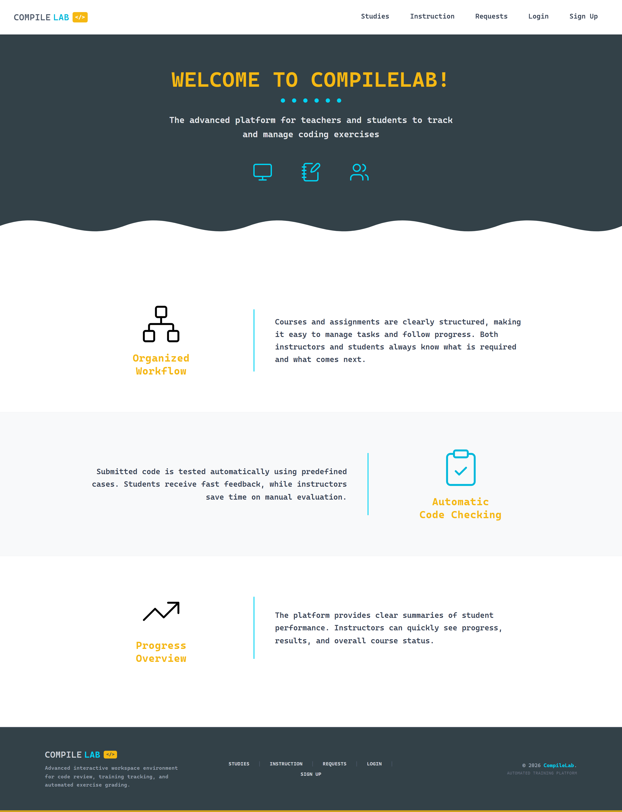
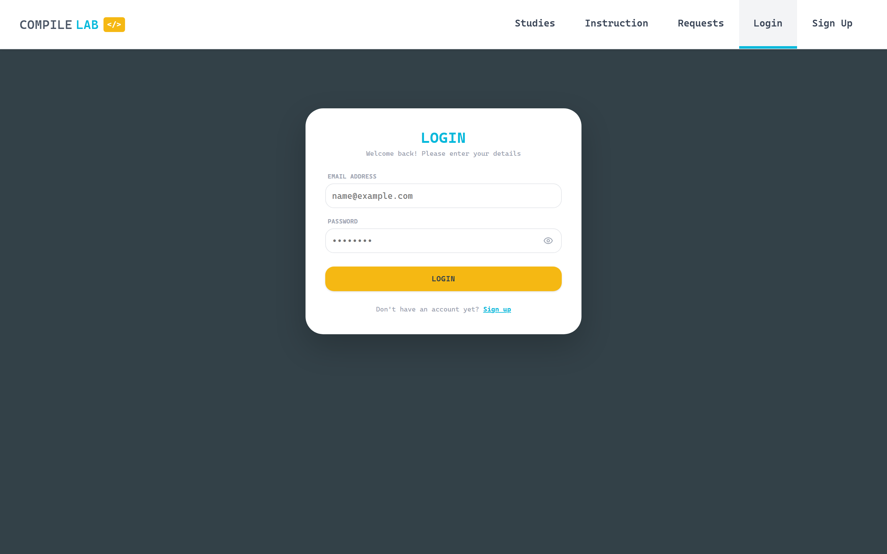
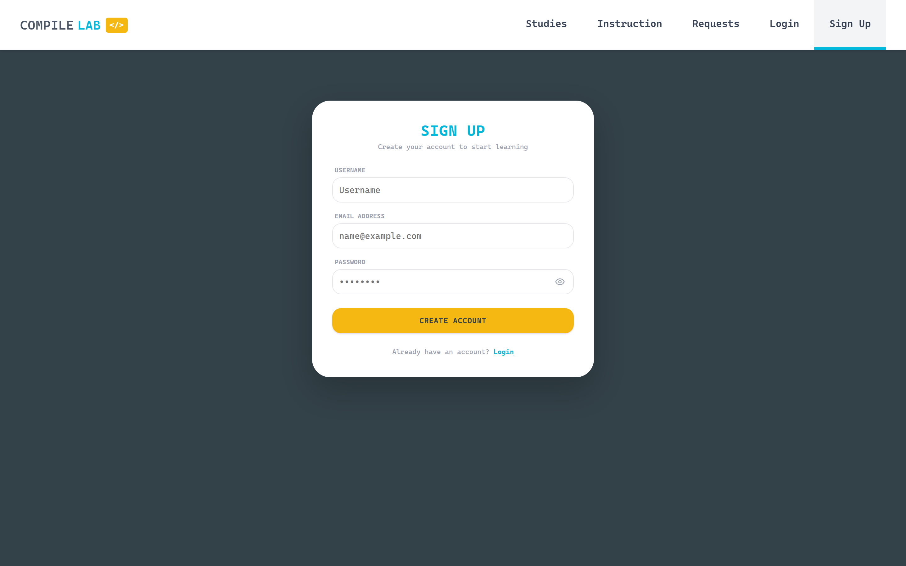
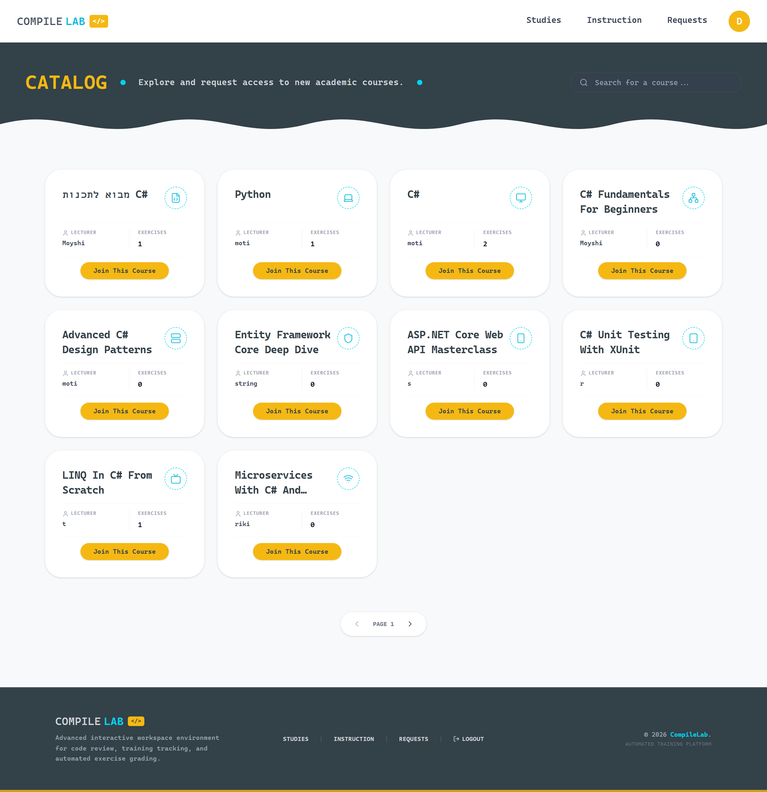
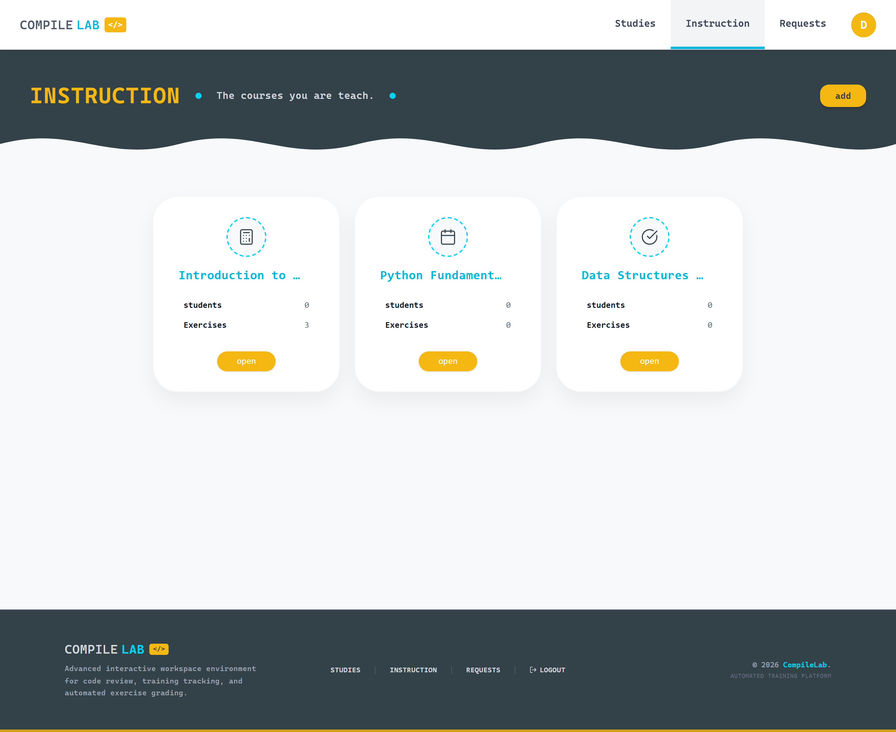
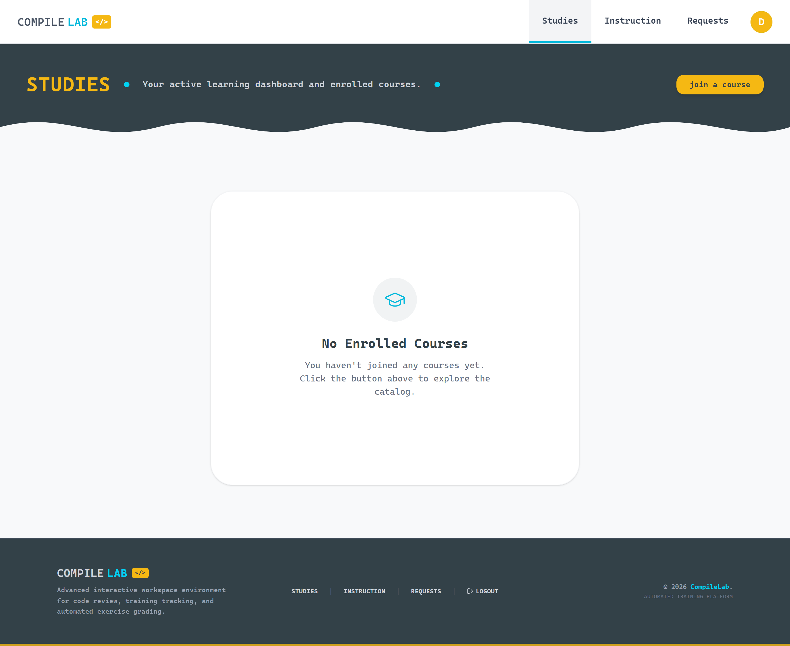

<div align="center">

# CompileLab

### The advanced platform for teachers and students to track and manage coding exercises

CompileLab is a full-stack educational platform where **instructors author programming exercises** and **students solve them in the browser**, submit their code, and receive automatically-evaluated results. It is split into two independent repositories — a **React** client and an **ASP.NET Core** Web API — that communicate over a typed, JWT-secured REST interface.

[](https://github.com/tzisman/compilelab-client)
[](https://github.com/tzisman/compileLab)
[](https://www.typescriptlang.org/)
[](https://www.microsoft.com/sql-server)

</div>

---

## Repositories

This is a multi-repository project. Each part is developed and versioned independently:

| Repository | Stack | Description |
|------------|-------|-------------|
| 🎨 **[compilelab-client](https://github.com/tzisman/compilelab-client)** | React 19 · TypeScript · Vite · Redux Toolkit · Tailwind | Single-page web front-end for students and instructors. |
| ⚙️ **[compileLab](https://github.com/tzisman/compileLab)** | .NET 9 · ASP.NET Core · EF Core · SQL Server · JWT | Layered REST Web API and data layer. |

> In this workspace the two repositories live side by side under `compilelab-client/` and `compilelab-server/`.

---

## Screenshots

> Captured from the running application (client on `:5173`, API on `:5035`).

### Landing & Authentication

| Home | Login | Sign Up |
|------|-------|---------|
|  |  |  |

### In the App

| Course Catalog | Instructor Courses | Student Dashboard |
|----------------|--------------------|-------------------|
|  |  |  |

---

## What CompileLab Does

| Role | Capabilities |
|------|--------------|
| **Student** | Browse a public course catalog, request to join courses, view assigned exercises, write and submit code in an in-browser workspace, and track grades. |
| **Instructor / Lecturer** | Create and manage courses, author code exercises, define test cases (input → expected output), approve or reject enrollment requests, and review per-student grade reports. |

### Core Concepts

- **Courses** are owned by a lecturer and contain **code exercises**.
- Students **enroll** in a course (an enrollment request the lecturer can approve or reject).
- Each exercise targets a **language** (C# or Python) and is validated by one or more **test cases**.
- Students submit **answers**, which are graded against the test cases (mark + remark).

---

## System Architecture

```
┌──────────────────────────────┐         HTTPS / REST + JWT        ┌──────────────────────────────┐
│        CompileLab Client       │  ───────────────────────────────▶ │        CompileLab Server        │
│  React 19 + TypeScript + Vite  │                                   │     ASP.NET Core 9 Web API      │
│                                │   GET/POST/PUT/DELETE  /api/...    │                                 │
│  • Redux Toolkit + RTK Query   │ ◀─────────────────────────────── │  • Controllers → Services       │
│  • React Router 7              │        JSON + Bearer token         │  • Generic Repository           │
│  • Tailwind + shadcn/Radix     │                                   │  • EF Core 9                    │
└──────────────────────────────┘                                   └───────────────┬──────────────┘
        http://localhost:5173                                                       │
                                                                                    ▼
                                                                          ┌───────────────────┐
                                                                          │   SQL Server DB    │
                                                                          └───────────────────┘
                                                                          http://localhost:5035
```

- The **client** holds all UI/UX, client-side routing, and a cache-aware data layer (RTK Query). It attaches a **JWT** to every request and centralizes error handling (401/403/404/500/network).
- The **server** exposes a clean **4-layer** REST API (`WebApi → Service → Repository → DataContext`), authenticates with JWT, hashes passwords with BCrypt, maps entities to DTOs with AutoMapper, and persists with EF Core.

---

## Quick Start

You need **two terminals** — one for the API, one for the client. Start the server first.

### 1. Server — ASP.NET Core API

```bash
cd compilelab-server/CompileLab.WebApi

# Apply migrations (creates the database)
dotnet ef database update --project CompileLab.DataContext --startup-project CompileLab.WebApi

# Run the API on http://localhost:5035  (Swagger at /swagger)
dotnet run --project CompileLab.WebApi
```

Configure your SQL Server connection string and JWT settings in
`compilelab-server/CompileLab.WebApi/CompileLab.WebApi/appsettings.json`.

### 2. Client — React app

```bash
cd compilelab-client/compile-lab

npm install
npm run dev    # http://localhost:5173
```

> The client expects the API at `http://localhost:5035` (configured in `src/api/apiSlice.ts`). Make sure the server is running before logging in.

---

## Prerequisites

| Tool | Version | Used by |
|------|---------|---------|
| Node.js | ≥ 18 (20+ recommended) | Client |
| npm | ≥ 9 | Client |
| .NET SDK | 9.0 | Server |
| SQL Server | LocalDB / Express / full | Server |
| EF Core CLI | `dotnet tool install --global dotnet-ef` | Server (migrations) |

---

<div align="center">

A full-stack project — **[Client](https://github.com/tzisman/compilelab-client)** · **[Server](https://github.com/tzisman/compileLab)**

</div>
